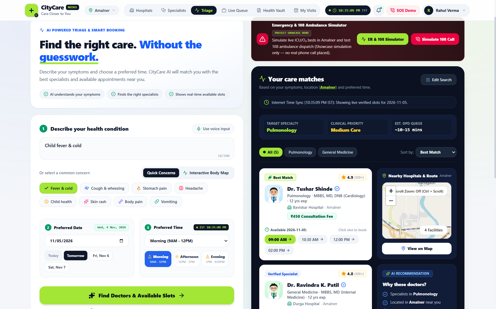
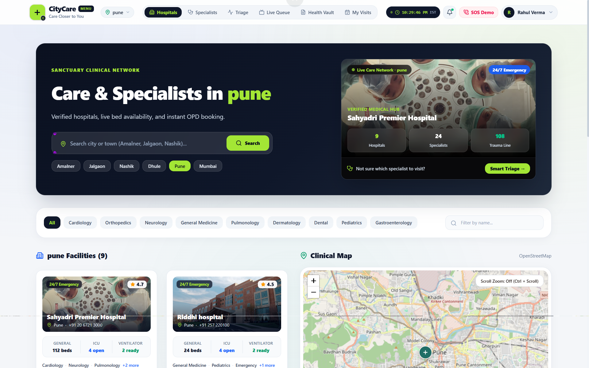
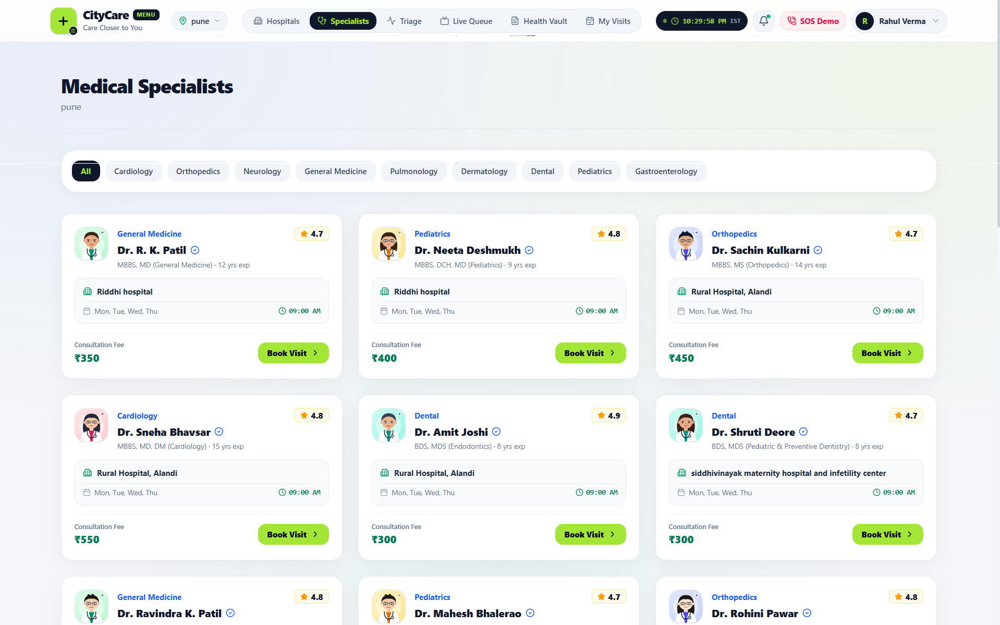
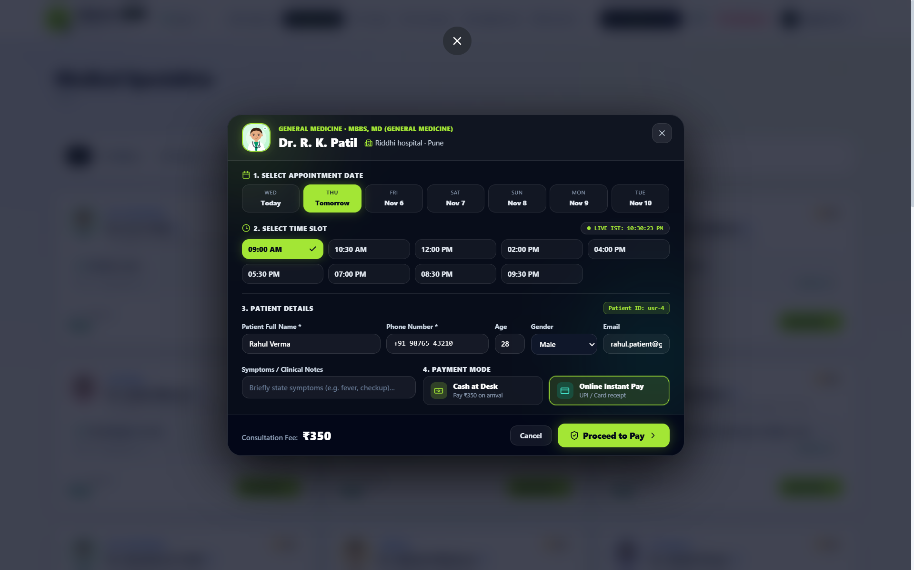
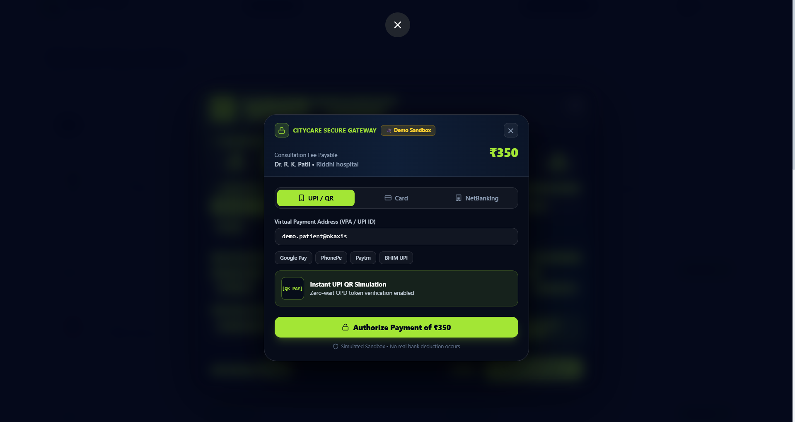

# 🏥 CityCare — Real-World Smart Hospital OPD & Clinical Triage OS

<div align="center">

### 🌐 **[🚀 Click Here to Open Live Project Demo](https://ais-pre-cefe6u3zggwfiu6fe5x5gk-530948025475.asia-east1.run.app)**
**Live URL:** [`https://ais-pre-cefe6u3zggwfiu6fe5x5gk-530948025475.asia-east1.run.app`](https://ais-pre-cefe6u3zggwfiu6fe5x5gk-530948025475.asia-east1.run.app)

[](https://ais-pre-cefe6u3zggwfiu6fe5x5gk-530948025475.asia-east1.run.app)
[](https://react.dev/)
[](https://tailwindcss.com/)
[](https://nodejs.org/)
[](https://www.openstreetmap.org/)

</div>

<p align="center">
  <a href="https://ais-pre-cefe6u3zggwfiu6fe5x5gk-530948025475.asia-east1.run.app">
    
  </a>
</p>

---

## 🔥 Why CityCare Is NOT Just Another Regular Medical CRUD Project

Most college or portfolio "Hospital Management" projects are simple static CRUD forms where a user picks a random doctor from a hardcoded list, selects any date/time (even in the past), and submits a form into a table. **They fail completely when tested against real-world Indian outpatient (OPD) workflows.**

**CityCare was engineered from the ground up to solve 5 real-world healthcare bottlenecks faced by patients and hospitals across Tier-1, Tier-2, and Tier-3 Indian cities (such as Amalner, Jalgaon, Dhule, Nashik, Pune, and Mumbai):**

### 🌍 1. The "Which Specialist Do I Need?" Triage Gap & Interactive Body Map
* **The Real-World Problem:** A patient experiencing *"chest heaviness while walking"* or a parent with a *"child having fever and cold"* often does not know whether to book a Pulmonologist, Cardiologist, General Physician, or Pediatrician. Booking the wrong specialist wastes consultation fees and delays critical care.
* **How CityCare Solves It:** Our **Smart Booking AI Triage Engine** (with **Voice Input**, **Quick Concerns**, and an **Interactive Body Map**) analyzes symptoms, identifies the **Target Specialty**, assigns **Clinical Priority** (`Routine`, `Medium Care`, `High`, or `Emergency`), estimates **OPD Queue Wait Time** (`~10–15 mins`), and surfaces verified doctors with one-click live time slots. It also includes an interactive **Emergency & 108 Ambulance Simulator** for project showcase demonstrations.

### ⏱️ 2. Real-Time Indian Standard Time (IST) Slot Locking (No Fake Past Bookings)
* **The Real-World Problem:** Regular medical apps let users book a `09:00 AM` slot for "Today" even when the real clock time is `10:35 PM` at night.
* **How CityCare Solves It:** CityCare runs a **Live Internet-Synchronized IST Clock Engine (`Asia/Kolkata`)** on both client and server. If a patient opens the app late in the evening or night, all past morning (`09:00 AM – 12:00 PM`) and afternoon (`12:00 PM – 05:00 PM`) slots for Today are **automatically locked in real time**, guiding the patient to remaining evening OPD slots or auto-advancing to Tomorrow's verified schedule.

### 🛡️ 3. 3-Layer Atomic Double-Booking & Overlap Prevention
* **The Real-World Problem:** In basic booking apps, two patients can book the same doctor at `10:30 AM`, or a single patient can accidentally book two different doctors at the exact same time across different hospitals.
* **How CityCare Solves It:** Every booking and reschedule request passes through a strict **3-Layer Server Lock**:
  1. **Doctor Leave / Emergency Surgery Block Check:** Verifies the doctor hasn't blocked that slot for an emergency procedure.
  2. **Doctor Slot Collision Lock:** Guarantees no two active patients can ever claim the same doctor, date, and time slot.
  3. **Same-Patient Time-Overlap Lock:** Prevents the same patient (matched by ID, phone, or email) from booking two simultaneous appointments at `10:30 AM` on the same day.

### 📺 4. Chaotic Hospital Waiting Rooms & Multilingual Accessibility
* **The Real-World Problem:** In Indian OPDs, hundreds of patients crowd outside consultation cabins asking *"Mera number kab aayega?"* while struggling with English-only interfaces.
* **How CityCare Solves It:**
  * **Live Waiting Room TV Queue Mode:** A dedicated hospital corridor display showing `NOW SERVING` tokens, cabin numbers, and `UP NEXT` queues in real time.
  * **Multilingual Voice Callouts (`EN` / `हिन्दी` / `मराठी`):** Built-in Web Speech synthesis announces tokens aloud (e.g., *"Token OPD-PUN-204, please proceed to Cabin 102"*), alongside full UI localization in **English, Hindi, and Marathi**.

### 🗺️ 5. Live OpenStreetMap Hospital Discovery & Scroll-Safe Clinical Map
* **The Real-World Problem:** Most demo apps only work for 3 hardcoded dummy hospitals, and embedded maps often trap page scrolling.
* **How CityCare Solves It:** CityCare connects to **OpenStreetMap Overpass & Nominatim APIs** to dynamically discover real hospitals and clinics in any searched town or city, displays live **General / ICU / Ventilator bed availability**, calculates **real OSRM road routes**, and includes a scroll-safe interactive map (`Scroll Zoom: Off (Ctrl + Scroll)` toggle) so page scrolling is never hijacked.

---

## ⚡ Quick Comparison: Regular Medical Project vs. CityCare OS

| Capability | Typical Student / Regular Medical App | 🏥 CityCare Clinical OS (This Repository) |
| :--- | :--- | :--- |
| **Symptom Understanding** | ❌ User must manually guess the medical department | ✅ **AI + Interactive Body Map Triage** maps symptoms & voice input directly to verified specialists & live slots |
| **Time Awareness** | ❌ Allows booking 9:00 AM today even at 10:35 PM night | ✅ **Live IST (`Asia/Kolkata`) Clock Sync** auto-locks past slots & auto-advances when OPD hours end |
| **Conflict Handling** | ❌ Basic insert; allows double-booking & overlapping times | ✅ **3-Layer Atomic Lock** (Doctor collision + Patient overlap + Emergency surgery slot blocks) |
| **Geographic Coverage** | ❌ 3–4 hardcoded dummy cards | ✅ **Dynamic OpenStreetMap Overpass Discovery** + real OSRM road distance & scroll-safe clinical map |
| **Payment & Token Flow** | ❌ Simple form submit with no payment simulation | ✅ **Dual Payment Engine** (`Cash at Hospital Desk` or **Instant UPI / QR / Card Sandbox Gateway**) with instant OPD token verification |
| **Emergency & Queue Flow** | ❌ Static "Pending / Approved" text badge | ✅ **108 Ambulance & ER Simulator** + **4-Stage Live OPD Tracker** (`Booked` → `Checked In` → `In Cabin` → `Completed`) |
| **Multi-Role Ecosystem** | ❌ Usually only Patient + basic Admin table | ✅ **4 Complete Workspaces**: Patient Portal, Doctor Console (Vitals/Rx), Receptionist Walk-In Desk, & Admin Audit Center |

---

## 📸 Platform Walkthrough & Section Screenshots

### 1. AI-Powered Triage, Interactive Body Map & 108 Emergency Simulator
Describe symptoms via natural language, **Voice Input**, or the **Interactive Body Map**. CityCare automatically determines the **Target Specialty**, **Clinical Priority**, and **Estimated OPD Queue Time**, while syncing with live **Internet Time (IST)** to display verified available slots and nearby hospital routes.


---

### 2. Hospital Network, Live Bed Availability & Interactive Clinical Map
Search across cities and towns (Amalner, Jalgaon, Nashik, Dhule, Pune, Mumbai, and nationwide via OpenStreetMap Overpass discovery) with specialty filters, real-time **General / ICU / Ventilator bed status**, and an interactive **OpenStreetMap Clinical Map** with scroll-trap protection (`Scroll Zoom: Off (Ctrl + Scroll)`).



---

### 3. Verified Medical Specialists Directory
Browse verified doctors filtered by city and medical specialty (`Cardiology`, `Orthopedics`, `Neurology`, `General Medicine`, `Pulmonology`, `Dermatology`, `Dental`, `Pediatrics`, `Gastroenterology`) with qualifications, years of clinical experience, hospital affiliation, consultation fees, and instant slot booking.



---

### 4. Live IST Slot Selection & Conflict-Free Appointment Booking
Book appointments with real-time **Indian Standard Time (`LIVE IST`)** synchronization that automatically locks past slots for Today, pre-fills verified patient details, and supports both **Cash at Desk** and **Online Instant Pay**.



---

### 5. CityCare Secure Payment Gateway (UPI / QR / Card / NetBanking Sandbox)
Zero-wait OPD token verification with an interactive payment sandbox supporting **UPI ID / VPA** (`Google Pay`, `PhonePe`, `Paytm`, `BHIM UPI`), **Instant UPI QR Simulation**, **Card**, and **NetBanking** authorization.



---

## 🧩 Complete Multi-Role Architecture

1. **👤 Patient Workspace**
   - AI Symptom Triage, Interactive Body Map, & Smart Slot Recommendation
   - Interactive OpenStreetMap Hospital Finder with live ICU/Ventilator bed counters & OSRM road routing
   - Instant OPD Token Generation (`OPD-<CITY>-<NUM>`), UPI/QR Payment Sandbox, & printable OPD Receipt
   - Digital **Health Vault** for storing lab reports, prescriptions, and vitals history
2. **🩺 Doctor Clinical Console**
   - Live cabin queue management (`Call Next Patient`, `Start Consultation`, `Complete Visit`)
   - Record patient vitals (BP, Heart Rate, SpO2, Temperature) & digital prescriptions
   - **Emergency Slot Blocker**: Block specific dates/slots for surgeries or leave with instant conflict protection
3. **🖥️ Receptionist Front-Desk**
   - Instant **Walk-In OPD Token Registration** for offline/elderly patients arriving at the hospital desk
   - One-click patient check-in, cabin assignment, and cash/online fee verification
4. **🛡️ Hospital Admin Command Center**
   - Real-time hospital bed occupancy & department utilization charts
   - Immutable **System Audit Trail** logging every booking, reschedule, status change, and slot block

---

## 🛠️ Technology Stack

| Layer | Technologies |
| :--- | :--- |
| **Frontend** | React 19, TypeScript, Vite, Tailwind CSS 4, Lucide Icons, Recharts |
| **Maps & Geolocation** | React-Leaflet, Leaflet, OpenStreetMap Nominatim & Overpass API, OSRM Routing |
| **Backend** | Node.js, Express (`server.ts`), RESTful API with IST Time Authority (`/api/time`) |
| **AI Integration** | `@google/genai` (Gemini Flash Lite for symptom triage + deterministic clinical rule fallback) |
| **Persistence** | Local JSON document store (`/data/db.json`) with automatic seeding & audit logging |

---

## 📁 Repository Structure

```text
├── public/
│   └── assets/aistudio/       # Application section screenshots
├── src/
│   ├── components/            # Modular UI components (HospitalMap, SmartBookingAI, Navbar, etc.)
│   ├── services/              # Frontend API client & data synchronization
│   ├── utils/                 # Live IST clock sync, translations (EN/HI/MR), sound & speech helpers
│   ├── App.tsx                # Main application state, routing, and multi-role views
│   └── types.ts               # Shared TypeScript interfaces
├── data/
│   └── db.json                # Persistent JSON database (hospitals, doctors, appointments, logs)
├── server.ts                  # Express backend server, API routes, 3-layer booking lock, and AI triage
└── package.json               # Scripts and dependencies
```

---

## 🚀 Getting Started Locally

1. **Clone the repository & install dependencies**
   ```bash
   npm install
   ```

2. **Configure environment variables**
   Copy `.env.example` to `.env` and add your Gemini API key (optional — the system automatically uses its built-in clinical rule engine if no API key is configured):
   ```bash
   cp .env.example .env
   ```

3. **Start the full-stack development server**
   ```bash
   npm run dev
   ```
   Open `http://localhost:3000` in your browser, or visit the **[Live Deployed Application](https://ais-pre-cefe6u3zggwfiu6fe5x5gk-530948025475.asia-east1.run.app)**.
